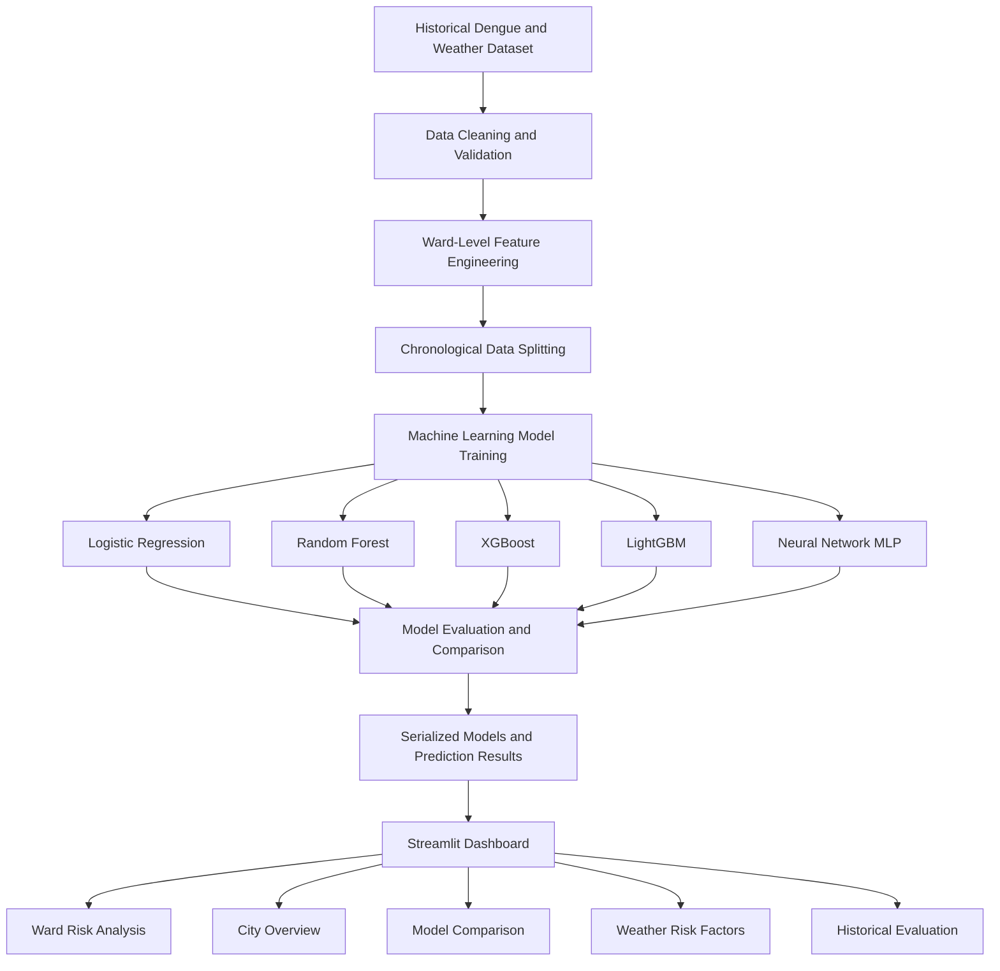

# DengueGuard AI — System Architecture

## 1. Project Overview

DengueGuard AI is a machine learning-based dengue risk prediction system designed to identify potentially high-risk dengue weeks at the ward level.

The system analyzes historical dengue cases, weather conditions, environmental factors, and ward-level characteristics to estimate dengue risk for three cities in Bangladesh:

- Chattogram
- Gazipur
- Narayanganj

The project uses five machine learning algorithms and supports two prediction horizons: 2 weeks and 4 weeks.

The Streamlit dashboard provides ward-level risk analysis, city comparisons, model performance metrics, weather-related risk factors, and historical prediction evaluation.

## 2. System Architecture Diagram



## 3. Dataset

The project uses historical weekly data covering 2016–2025.

Dataset characteristics:

- 20 wards
- 3 cities
- 10,440 weekly observations
- Historical dengue case counts
- Weather variables such as temperature, humidity, and rainfall
- Ward-level environmental and demographic characteristics

The dataset supports ward-specific analysis and multi-week risk prediction.

## 4. Data Cleaning and Preprocessing

The preprocessing pipeline prepares historical records for machine learning.

The pipeline is designed to:

1. Validate the dataset structure.
2. Handle missing or invalid values.
3. Standardize date and ward identifiers.
4. Arrange observations chronologically.
5. Prepare numerical and categorical features.
6. Produce cleaned data for feature engineering and model training.

The project includes preprocessing scripts in the `src/` directory.

## 5. Feature Engineering and Weather Lag Pipeline

Dengue risk can be influenced by environmental conditions occurring before an outbreak.

The project therefore uses historical weather observations and temporal features.

Feature categories include:

- Temperature
- Rainfall
- Humidity
- Waterlogging
- Sanitation conditions
- Population density
- Historical dengue case counts
- Lagged observations
- Rolling-window statistics
- Calendar-related features

Temporal features must be calculated separately for each ward to avoid mixing observations between locations.

For example, a ward's previous rainfall measurements should come from that same ward, not another ward.

Only information available at the prediction date should be used when constructing features.

## 6. Prediction Targets

The system supports two forecast horizons:

**2-week prediction:** Estimates whether a ward will experience a high-risk dengue week at the target date two weeks ahead.

**4-week prediction:** Estimates whether a ward will experience a high-risk dengue week at the target date four weeks ahead.

The project's binary high-risk threshold is four or more weekly dengue cases.

This threshold is a project-specific classification rule, not an official public-health alert threshold.

The model outputs a probability between 0 and 1.

For dashboard classification, probabilities of 0.50 or higher are labeled High Risk, while lower probabilities are labeled Low Risk.

## 7. Machine Learning Models

Five algorithms are used:

| Model | Purpose |
|---|---|
| Logistic Regression | Interpretable statistical classification baseline |
| Random Forest | Ensemble learning using decision trees |
| XGBoost | Gradient-boosted tree classification |
| LightGBM | Efficient gradient-boosted tree classification |
| Neural Network MLP | Nonlinear classification using a multilayer perceptron |

Models are trained and evaluated separately for the 2-week and 4-week prediction tasks.

## 8. Chronological Training, Validation, and Testing

The project uses time-based data splitting rather than randomly distributing weekly observations.

The intended chronological partitioning is:

- Training: Historical observations before 2022
- Validation: 2022–2023
- Testing: 2024–2025

The validation period supports model comparison and selection.

The final test period evaluates performance on later historical observations.

**Data leakage prevention:**

- Keep training, validation, and test periods chronologically separated.
- Generate lagged features using past observations only.
- Group temporal feature calculations by ward.
- Fit preprocessing transformations using training data rather than future test data.
- Ensure future dengue outcomes are not used as prediction-time inputs.
- Respect the target forecast horizon when constructing training and evaluation examples.

The exact split boundaries and leakage controls should be verified against the training scripts before final submission.

## 9. Model Evaluation

Models are compared using:

- Accuracy
- Precision
- Recall
- F1-score
- ROC-AUC

F1-score balances precision and recall.

Recall is particularly relevant because missing a genuinely high-risk ward can be costly in an early-warning application.

Model selection is performed separately for the two forecast horizons.

The saved project metadata identifies the selected best-performing model for each horizon.

## 10. Prediction and Inference Architecture

The training pipeline produces serialized machine learning models and prediction artifacts.

These are stored in the `model/` directory.

The project includes saved outputs for the 2-week and 4-week horizons.

The current Streamlit dashboard primarily reads saved historical test predictions, allowing users to compare model outputs across wards, cities, and dates.

Although trained model artifacts are available, dynamic inference from newly entered weather conditions still requires end-to-end integration and verification in the dashboard.

Therefore, the historical evaluation interface should not be presented as a real-time dengue forecasting service.

## 11. Interactive Dashboard

The Streamlit application is located at:

`app/app.py`

The dashboard provides five main views:

**Ward Explorer:** Displays individual ward risk probabilities and classifications.

**City Overview:** Compares dengue risk across the supported cities.

**Model Comparison:** Presents evaluation results for the trained algorithms.

**Weather Drivers:** Displays weather-related and other model input factors.

**Historical Trends:** Compares historical model predictions with observed high-risk labels.

Users can select prediction horizons, machine learning models, cities, and available historical prediction dates.

## 12. Performance and Cost Efficiency

The system is designed to run locally using Python and saved model artifacts.

Its efficiency approach includes:

- Reusing previously trained models.
- Loading saved prediction results instead of retraining on every dashboard interaction.
- Using Streamlit caching where appropriate.
- Using local data files for historical evaluation.
- Avoiding unnecessary external API requests.

The existing prediction pipeline does not require a large language model or a paid generative AI API.

Performance, caching behavior, and fresh-install execution time should be measured before final submission.

## 13. Repository Structure

```text
dengue-risk-prediction-system/
├── app/
│   └── app.py
├── data/
├── docs/
├── model/
├── notebooks/
├── src/
├── ARCHITECTURE.md
├── README.md
├── requirements.txt
└── .gitignore
```

The main components are:

- `app/`: Streamlit user interface
- `data/`: Project datasets
- `docs/`: Supporting technical documentation
- `model/`: Trained models, evaluation results, and prediction artifacts
- `notebooks/`: Exploratory analysis and experiments
- `src/`: Data preparation, feature engineering, training, and prediction scripts

## 14. Limitations

The system has several important limitations:

1. Training data covers a limited set of wards and cities.
2. Historical predictive performance does not guarantee future performance.
3. The dashboard's historical prediction results are not live surveillance data.
4. Environmental and case-reporting patterns may change over time.
5. Model feature importance does not establish causal relationships.
6. The binary high-risk threshold is project-specific.

DengueGuard AI is a university machine learning project and should not be treated as an official public-health warning system.

## 15. Future Improvements

Potential improvements include:

- Fully integrated dynamic inference using new weather inputs.
- Automated updates from verified weather and dengue surveillance sources.
- Interactive ward-level geographical risk visualization.
- Model uncertainty estimates.
- Improved explanation of weather-related predictions.
- Additional validation on future observations and new geographical regions.

## 16. Conclusion

DengueGuard AI combines ward-level historical data, temporal feature engineering, five machine learning classifiers, and an interactive Streamlit dashboard.

Its architecture separates data preparation, model development, evaluation, serialized prediction artifacts, and presentation.

This modular design supports reproducible experimentation and future extension toward an operational dengue early-warning application.