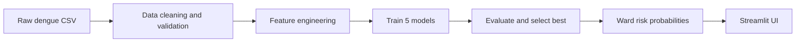

# Dengue Risk Prediction System

Predicts the probability of a high-risk dengue week for each ward in Chattogram, Gazipur and Narayanganj, using weekly weather, ward conditions and past cases. We use classical statistical ML and a small neural network, with no LLM or generative AI in the prediction pipeline.

## Team
- Bushra Umme Humaira - Data cleaning and feature engineering
- Sidratul Muntaha - Machine learning prediction engine
- Athkia Tabassum Chowdhury - Streamlit dashboard

## Architecture


## Dataset
Weekly data for 20 wards in 3 cities, 2016-2025 (10,440 rows): weather, ward conditions and weekly dengue cases.

## Models
Logistic Regression, Random Forest, XGBoost, LightGBM and a neural network (MLP). They are trained on 2016-2023 and tested on 2024-2025, and compared with accuracy, precision, recall, F1 and ROC-AUC. See docs/models.md.
## Quick Start — Run the Dashboard

Clone the repository:

```powershell
git clone https://github.com/BushraUmmeHumaira/dengue-risk-prediction-system.git
cd dengue-risk-prediction-system
```

Create a virtual environment:

```powershell
python -m venv .venv
```

Install dependencies:

```powershell
.\.venv\Scripts\python.exe -m pip install -r requirements.txt
```

Launch the dashboard:

```powershell
.\.venv\Scripts\python.exe -m streamlit run app/app.py
```

The dashboard uses pre-trained model files and saved evaluation results when they are available. Model retraining is not required for normal dashboard usage.

## Forecasting and Evaluation

DengueGuard AI supports two prediction horizons:

- **2 weeks ahead**
- **4 weeks ahead**

Five machine learning algorithms are evaluated: Logistic Regression, Random Forest, XGBoost, LightGBM, and a Multi-Layer Perceptron (MLP).

The project uses chronological data splitting:

- **Training:** 2016–2021
- **Validation:** 2022–2023
- **Testing:** 2024–2025

Model selection is performed using validation results before final evaluation on the test period.

## Dynamic Prediction

The Dynamic Prediction tab allows users to select a city, ward, and historical observation week.

Users can adjust rainfall, average temperature, and relative humidity to explore how the saved ML model responds to different weather inputs.

The dashboard displays:

- Predicted high-risk probability
- Change from the original weather scenario
- Predicted risk category
- Selected forecasting horizon and model

**Important:** These are historical what-if scenarios, not live dengue forecasts. Changes in predicted probability do not establish causal effects.

## System Architecture

For the complete data pipeline, feature engineering, model selection, and system design, see [ARCHITECTURE.md](ARCHITECTURE.md).

## Performance and Cost Considerations

- Trained models are serialized using joblib.
- The prediction engine caches loaded models to avoid repeated disk loading.
- Streamlit caches selected data-loading operations.
- Predictions run locally without requiring a paid AI inference API.
- Historical dashboard results can be loaded from saved prediction files instead of retraining models.

## AI Assistance Disclosure

AI-assisted development tools, including ChatGPT, were used to support coding, debugging, documentation, and dashboard development.

The dengue risk predictions themselves are generated by trained machine learning models, not a generative AI or large language model.

The team remains responsible for reviewing the code, verifying results, and validating the final implementation.

## Limitations

- The dataset covers 20 wards across three cities.
- The current dashboard is based on historical observations and evaluation data.
- A high-risk week is defined in this project as four or more dengue cases.
- Predictions are statistical estimates and should not replace official public-health surveillance or professional judgment.

## How to run
python -m venv venv
venv\Scripts\activate
pip install -r requirements.txt
python src/clean_data.py
python src/feature_report.py
python src/train.py
streamlit run app/app.py